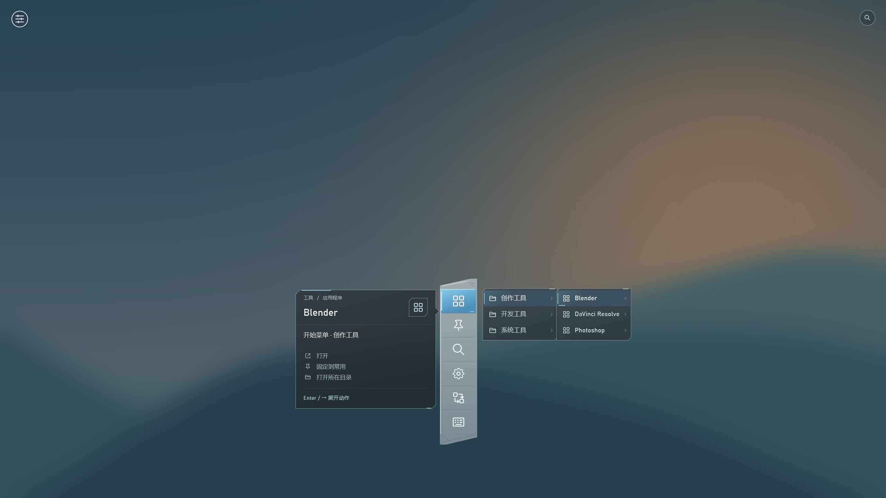
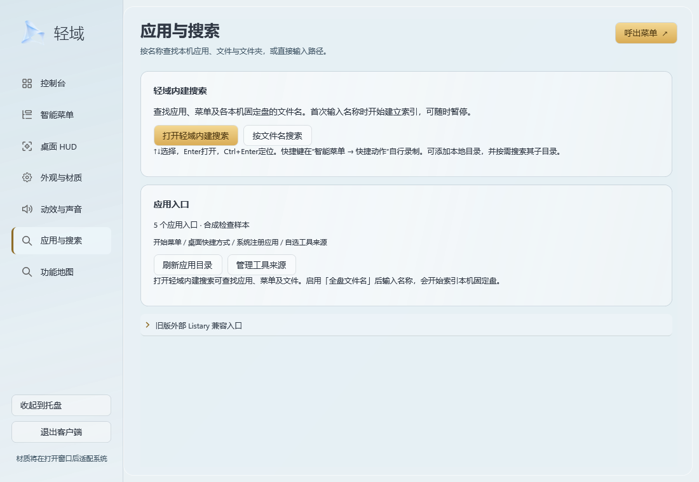

# 轻域 Qingyu

轻域是 Windows 个人桌面工作区。平时在托盘运行，需要时用快捷键呼出菜单或搜索，便签和其他选定的挂件可独立留在桌面。

[下载 R146 · Windows x64 预览版](https://github.com/NOXEVYR/qingyu-releases/releases/download/v0.3.146-preview/Qingyu-R146-win-x64.zip) · [版本说明与校验文件](https://github.com/NOXEVYR/qingyu-releases/releases/tag/v0.3.146-preview)

## 首次使用

完整解压到可写的本地目录，双击「轻域 R146.exe」。再次双击或点击托盘图标打开控制台，在「智能菜单」中设置自己的呼出键。[安装要求与操作说明](使用说明.md)

## 常用操作

- 快捷键展开多级菜单。方向键选择，Esc 逐级返回，再次呼出可收起整层。
- 在「应用与搜索」输入本机文件名。Enter 打开结果，Ctrl+Enter 在资源管理器中定位。固定盘名称索引会在首次输入时建立，可随时暂停。
- 在挂件库编辑便签、天气、音频频谱或常用入口。各个挂件可以移动、锁定、隐藏、找回，也可以设为仅在呼出菜单时显示。
- 把同一项工作用到的窗口编成一组，一起切换、最小化、恢复，或启用联动拖动。

此仓库用于发布预览版程序及文档。程序包附带第三方组件声明。
